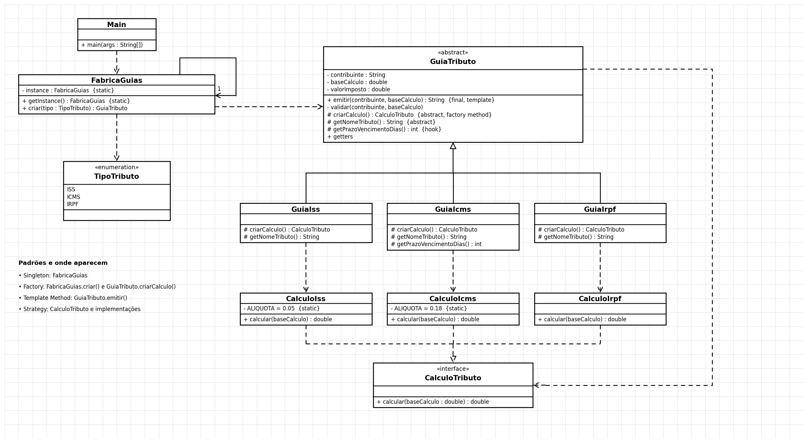

# Integração dos padrões Strategy + Factory + Template Method + Singleton
## Tema: emissão de guias de tributos

## Onde cada padrão aparece
| Padrão | Classe(s) | Papel |
|---|---|---|
| **Singleton** | `FabricaGuias` | Existe uma única fábrica de guias (construtor privado + instância estática) |
| **Factory** | `FabricaGuias.criar(TipoTributo)` | Escolhe a guia a criar; o cliente não conhece as classes concretas |
| **Factory Method** | `GuiaTributo.criarCalculo()` | Cada subclasse decide qual estratégia de cálculo criar |
| **Template Method** | `GuiaTributo.emitir()` (`final`) | Fixa a sequência: validar, criar cálculo, calcular, arredondar, gerar documento |
| **Strategy** | `CalculoTributo`, `CalculoIss`, `CalculoIcms`, `CalculoIrpf` | Algoritmos de cálculo intercambiáveis |

## Como os padrões se integram
```
Main -> FabricaGuias.getInstance()            (Singleton)
     -> criar(TipoTributo.IRPF)               (Factory)       => GuiaIrpf
     -> guia.emitir("Maria", 5000.0)          (Template Method)
            validar()
            criarCalculo()                    (Factory Method) => new CalculoIrpf()
            calculo.calcular(5000.0)          (Strategy)
            arredondar() / gerarDocumento()
```
- Quem **cria** a guia: a fábrica (Singleton).
- Quem define o **fluxo** da emissão: a classe abstrata (Template Method).
- Quem define **qual cálculo** usar: a subclasse, via Factory Method.
- Quem **calcula**: a Strategy.

## Tributos
| Tributo | Cálculo | Vencimento |
|---|---|---|
| ISS | 5% da base | 30 dias |
| ICMS | 18% da base | 10 dias (gancho sobrescrito) |
| IRPF | tabela progressiva **simplificada e didática** (não é a oficial) | 30 dias |

## Diagrama UML


(gerado por `docs/gerar_uml.py`)

## Executar
```
mvn test
mvn compile exec:java -Dexec.mainClass=padroescomportamentais.integracao.Main
```
Requer JDK 11+ e Maven. No IntelliJ: *File > Open* e escolha a pasta (ou o `pom.xml`).

## Testes
- `CalculoTributoTest` — Strategy: cada algoritmo e as fronteiras das faixas do IRPF.
- `GuiaTributoTest` — Template Method + Factory Method: documento por tipo, ordem dos passos (subclasse "espiã"), gancho, arredondamento e validações.
- `FabricaGuiasTest` — Singleton + Factory: instância única, construtor privado, tipo criado, todos os valores do enum cobertos.
- `IntegracaoPadroesTest` — fluxo completo com os quatro padrões.
